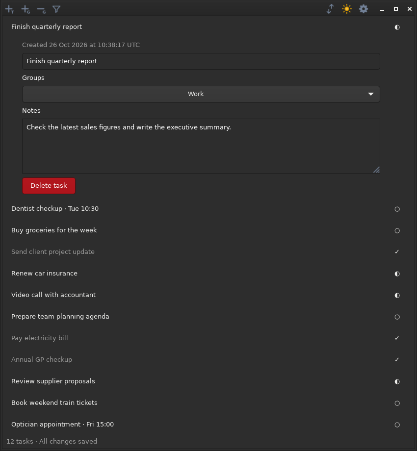

# Tabella

A lightweight native Ubuntu desktop task list using GTK 4, Python 3, and
SQLite. Uses PyGObject for GTK bindings, with no browser runtime, server, or
network connection required to run.

Created for my personal use, but easy for anyone else to use it too.



### Features
- Task tracking with titles, grouping, descriptions and completion statuses
- Persistence for all task data and settings
- Format mode (enabled by default): tab-indented rows wrap under their first
  word with a matching right inset; toggle paragraph alignment in Settings.
- Show format bar (enabled by default): toggle the Bold, Italic and Underline
  header inside descriptions and Notes independently of Format mode. Styles
  can be combined and are saved automatically; hiding the bar preserves them.
- Group visibility toggling
- Dark mode
- System theme opt-in/out
- Row height resizing
- Row re-ordering (via dragging)
- Manual data back-up/exporting
- 100% local storage

## Run

On Ubuntu 22.04 or later, install the required packages if needed:

```sh
sudo apt install python3 python3-gi gir1.2-gtk-4.0
```

Then run from this repository:

```sh
make run
```

`make run`, `make test` and `make test-ui` use `python3` from your `PATH`.
An activated virtual environment therefore supplies their interpreter. Override
it explicitly with `make run PYTHON=/path/to/venv/bin/python`, or select Ubuntu's
interpreter with `make run PYTHON=/usr/bin/python3`. Tabella is loaded directly
from the current checkout, so it does not need a system-wide package install.

### Virtual environment

For development on Ubuntu, reuse the distribution's GTK bindings in a virtual
environment created with the distribution's Python:

```sh
sudo apt install python3-venv python3-gi gir1.2-gtk-4.0
/usr/bin/python3 -m venv --system-site-packages .venv
source .venv/bin/activate
python -m pip install -r requirements.txt
make run
```

`requirements.txt` lists the Python dependency, PyGObject (`gi`). The
`--system-site-packages` option lets the virtual environment use Ubuntu's
installed copy while keeping development packages in the virtual environment.
GTK 4 and its introspection data still come from Ubuntu packages.

For a fully isolated environment, install the native build dependencies for
your Ubuntu and PyGObject versions before installing `requirements.txt`; see
the [PyGObject installation guide](https://pygobject.gnome.org/getting_started.html#ubuntu-debian)
and [system dependency compatibility](https://pygobject.gnome.org/guide/sysdeps.html).

The `./Tabella` desktop launcher continues to use Ubuntu's `/usr/bin/python3`.
Use `make run` to launch the current checkout with a virtual environment.

To add Tabella to your application menu:

```sh
make install
```

Launch **Tabella** from the menu. Run `make install` again after updating the
source.

## Database and backups

The default database is `~/.local/share/Tabella/tasks.sqlite3`. For a separate
task list, run `./Tabella --database /absolute/path/to/work.sqlite`; Tabella
creates the file if needed and opens another instance.

Tabella upgrades older databases automatically when opened. Back up your data
with **Settings → Export**.

## Checks

```sh
make test       # storage tests; standard library only, no display required
make test-ui    # GTK integration tests; requires the Ubuntu xvfb package
```

Install the display dependency with `sudo apt install xvfb` if needed. The UI
tests start and stop a private Xvfb display, so their windows do not appear on
your desktop. Run them with `make test-ui`; Xephyr creates a visible window and
should not be used for test runs.

Tests use temporary databases and do not modify your task list.

## Docker development and tests

Build a development image with the app, GTK 4, system Python, Git, Make, and
Xvfb. The Dockerfile pins the Ubuntu base image by digest and uses a dated
Ubuntu package snapshot, so rebuilding it installs the same dependency versions.

```sh
docker build -t tabella-dev .
docker run --rm tabella-dev                # storage and headless GTK tests
docker run --rm tabella-dev make test     # storage tests only
```

To test edits without rebuilding the image, mount the working tree:

```sh
docker run --rm -v "$PWD":/workspace tabella-dev
```

The container uses Xvfb for UI tests. To launch the desktop app itself, use
`make run` on Ubuntu as described above.
